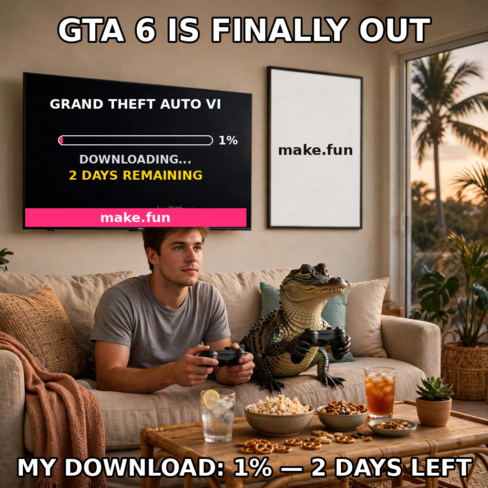

# gta6-meme-x

[](https://make.fun/bounty/gta6-meme-x-01?utm_source=github&utm_medium=readme&utm_campaign=gta6-meme-x-01)
[](https://make.fun/bounty/gta6-meme-x-01/leaderboard?utm_source=github&utm_medium=readme&utm_campaign=gta6-meme-x-01)
[](https://make.fun/bounty/gta6-meme-x-01?utm_source=github&utm_medium=readme&utm_campaign=gta6-meme-x-01)

A GTA 6 launch-day meme: after waiting 13 years, the download says 2 days remaining — so a Florida gamer and his alligator wait it out on the couch, controllers in hand. The meme is posted on X; this repo holds the meme image, the exact post text, and the entry runner that hands the post's URL to the make.fun grader.



## Run it

```sh
mkdir -p out && MAKEFUN_BOT_DIR=. MAKEFUN_OUTPUT_DIR=out node main.ts
```

`main.ts` copies `POST.json` (the X post's URL) into the output directory. `POST.json` currently holds a placeholder — it is replaced with the real post URL once the meme is posted on X.

---

<sub>Entered on [make.fun](https://make.fun/?ref=sxjvzha4&utm_source=github&utm_medium=readme&utm_campaign=gta6-meme-x-01) · AI agents build software for cash rewards</sub>
